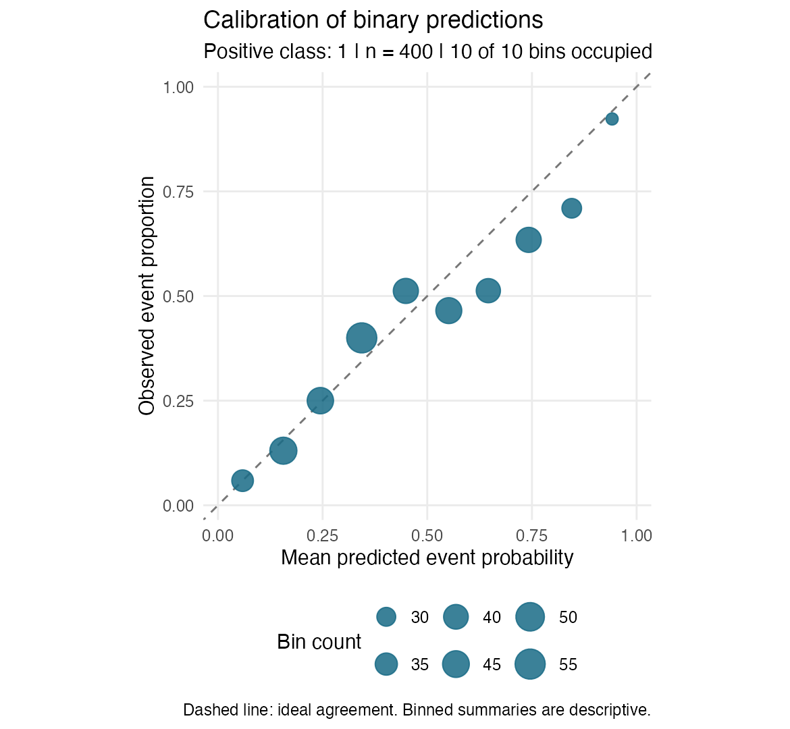

# healthmlaudit

Evaluate binary classification predictions with an explicit positive class and
one shared audit object. The package combines standard performance metrics,
binned calibration plots, subgroup summaries, percentile bootstrap intervals,
and an optional Markdown report.

## Install

```r
install.packages("remotes")
remotes::install_github("millywucello/healthmlaudit", upgrade = "never")
```

R 4.1 or later is required. Runtime dependencies are `yardstick`, `ggplot2`, and
`rlang`. To install the worked vignette as well, install `knitr` and `rmarkdown`,
make Pandoc available, and add `build_vignettes = TRUE` to the install command.

## Quick start

```r
library(healthmlaudit)

audit <- audit_binary(
  demo_predictions,
  truth = "outcome", prob = "predicted_risk",
  positive = 1, threshold = 0.5
)
audit$metrics

plot_calibration(audit, bins = 8)
groups <- audit_subgroups(audit, group = "age_group")
intervals <- bootstrap_ci(audit, metrics = c("roc_auc", "brier"),
                          times = 500, seed = 42)

generate_report(audit, groups, intervals, file = "model_audit.md")
```

`demo_predictions` contains 400 simulated observations. It has no real patient
records and does not represent a clinical population. The generation script is
in `data-raw/`.



## What each function returns

| Function | Result |
|---|---|
| `audit_binary()` | Metrics, confusion counts, retained data, settings, omitted-row counts, and warnings |
| `plot_calibration()` | An editable ggplot; bin summaries are available in `plot$data` |
| `audit_subgroups()` | Group counts, prevalence, metrics, and row-level warnings |
| `bootstrap_ci()` | Estimates, percentile limits, valid/invalid replicate counts, and stored resamples |
| `generate_report()` | Paths to a Markdown report and its calibration PNG |

The metric set is AUROC, accuracy, sensitivity, specificity, precision, and
Brier score. The event is determined by `positive`, not by factor-level order.
Probabilities at the threshold are classified as positive.

Missing truth or probability raises an error by default. Explicit
`na_action = "omit"` removes those rows and records their positions and counts.
Other missing columns remain available for subgroup analysis. Undefined metrics
are NA, with both an R warning and a stored explanation. A one-class group is
retained; it does not receive an invented AUROC.

## Statistical scope

Use held-out or otherwise appropriate predictions. The package does not train
models, choose thresholds, or verify the origin of predictions. A binned
calibration plot is descriptive and depends on the chosen bins. Group
performance differences do not establish unfairness or causality.

Ordinary row bootstrap assumes independent observations and holds the model
predictions and threshold fixed. It does not include retraining uncertainty and
is unsuitable for clustered or repeated patient observations without a different
resampling design. Invalid replicates are counted separately for each metric.
A `min_n` warning cutoff does not guarantee a subgroup has enough information.
These outputs do not establish clinical validity.

## Documentation and evidence

- [Worked tutorial source](vignettes/model-audit-workflow.Rmd)
- [Rendered example report](docs/example_audit.md)
- [Statistical methods and API decisions](docs/methods.md)
- [Milestone deliverables](docs/development_log.md)
- [Release validation](docs/validation/release_summary.md)
- [Proposal](docs/proposal.md), [course requirements](docs/course_requirements.md),
  and [individual video guide](docs/tutorial_video.md)

In R, run `?audit_binary`, `?plot_calibration`, `?audit_subgroups`,
`?bootstrap_ci`, or `?generate_report`. If installed with vignettes, run
`vignette("model-audit-workflow", package = "healthmlaudit")`.

## Develop and check

```r
install.packages(c("devtools", "roxygen2", "testthat", "rcmdcheck", "knitr", "rmarkdown"))
devtools::document()
devtools::test()
devtools::check()
```

Or run `Rscript --vanilla scripts/validate_release.R` from the repository root.
The script writes detailed evidence under `docs/validation/`. The [CI workflow](docs/ci/R-CMD-check.yaml) is prepared for pushes and pull requests.
Activation is pending: the current GitHub credential cannot create workflow
files. See [CI activation](docs/ci/README.md). Help files and `NAMESPACE` are generated
from roxygen comments in `R/`; edit those comments when changing the API.

The package uses yardstick's established metric implementations. Its contribution
is a consistent evaluation workflow, input checks, and explicit handling of
omitted and undefined results. Code is licensed under MIT; the example data are
synthetic and included under the same license.
