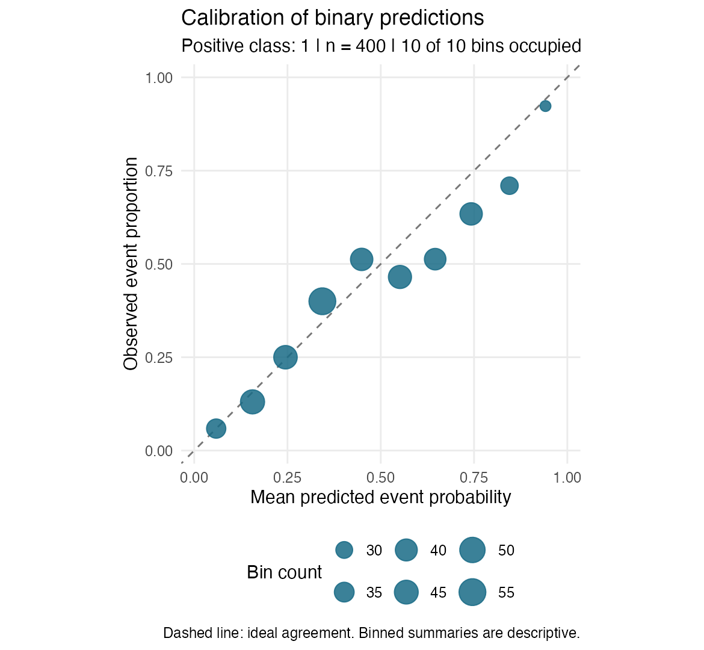

# Binary prediction audit

Positive class: 1. Classification threshold: 0.5 (probability >= threshold).

Observations used: 400 of 400. Omitted for missing truth or probability: 0.

## Performance

| metric | value |
| --- | --- |
| n | 400 |
| positive\_n | 174 |
| negative\_n | 226 |
| prevalence | 0.435 |
| tp | 112 |
| fp | 68 |
| tn | 158 |
| fn | 62 |
| roc\_auc | 0.7629 |
| accuracy | 0.675 |
| sensitivity | 0.6437 |
| specificity | 0.6991 |
| precision | 0.6222 |
| brier | 0.1983 |

AUROC measures ranking; Brier score is mean squared probability error. Classification metrics depend on the stated threshold. NA means undefined, not zero.

## Calibration

Points show occupied equal-width bins. The diagonal denotes ideal agreement. Bin counts are shown by point size.

## Subgroup results

Grouping variable: age\_group.

| group | n | positive\_n | negative\_n | prevalence | roc\_auc | accuracy | sensitivity | specificity | precision | brier |
| --- | --- | --- | --- | --- | --- | --- | --- | --- | --- | --- |
| Under 60 | 200 | 74 | 126 | 0.37 | 0.7616 | 0.715 | 0.3919 | 0.9048 | 0.7073 | 0.1897 |
| 60+ | 200 | 100 | 100 | 0.5 | 0.7621 | 0.635 | 0.83 | 0.44 | 0.5971 | 0.207 |

NA group labels indicate missing subgroup values. Differences do not establish bias or fairness.

## Bootstrap intervals

| metric | estimate | lower | upper | conf\_level | n\_requested | n\_valid | n\_invalid | seed |
| --- | --- | --- | --- | --- | --- | --- | --- | --- |
| roc\_auc | 0.7629 | 0.712 | 0.8096 | 0.95 | 500 | 500 | 0 | 42 |
| brier | 0.1983 | 0.1783 | 0.221 | 0.95 | 500 | 500 | 0 | 42 |

Percentile intervals use ordinary row resampling and type-7 quantiles. Invalid resamples are excluded separately by metric. A seed of NA means the current RNG was used.

## Warnings

No data-specific warnings were raised.

## Scope

Use held-out or otherwise appropriate evaluation predictions. The package cannot verify how predictions were generated. Ordinary row bootstrap assumes independent observations and does not include model-retraining or threshold-selection uncertainty. Clustered or repeated patient records need a different resampling design. These results do not establish clinical validity.
